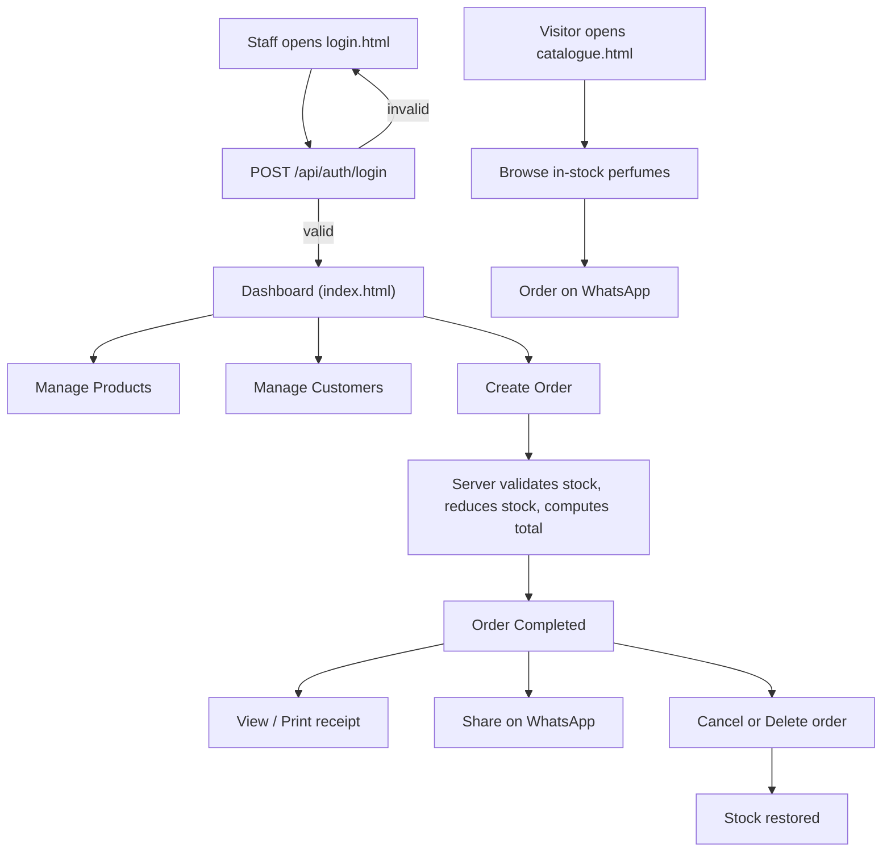

# Perfume Shop Manager — Product Requirements Document (PRD)

## 1. Product Overview

Perfume Shop Manager is a small-business web tool that lets a perfume seller manage products (perfumes), customers and sales orders in one place, with a public read-only catalogue for walk-in customers.

It solves the problem of tracking stock, recording sales and knowing daily/monthly revenue without spreadsheets. Target users are small perfume retailers and their staff. Target value: a single, elegant, low-cost system that runs on one Node.js server.

## 2. Core Features

### 2.1 User Roles

| Role | Registration Method | Core Permissions |
|------|---------------------|------------------|
| Staff (Admin) | Seeded account only (no public sign-up) | Full CRUD on products, customers and orders; view dashboard |
| Visitor | None (public pages) | Browse the public catalogue and contact the seller via WhatsApp |

### 2.2 Feature Module

1. **Login page**: email + password form, validation, redirect to dashboard.
2. **Dashboard**: KPI stat cards, 7-day sales line chart, best-sellers chart, low-stock alert table with restock shortcut.
3. **Perfumes page**: search/filter/paginate product cards, add/edit modal, delete with confirmation.
4. **Customers page**: searchable, paginated customer table, add/edit modal, delete with confirmation.
5. **Orders page**: order table, multi-line new-order modal with live total, receipt view/print, WhatsApp share, edit, cancel, delete.
6. **Catalogue page (public)**: no login, read-only product grid with WhatsApp enquiry button.

### 2.3 Page Details

| Page Name | Module Name | Feature description |
|-----------|-------------|---------------------|
| Login | Login form | Email/password fields with Bootstrap validation; shows error toast on failure; stores JWT and redirects to dashboard |
| Dashboard | Stat cards | Today's Sales, This Month's Sales, Total Orders, Low-Stock Items (computed from Completed orders only) |
| Dashboard | Sales chart | Chart.js line chart of sales totals for the last 7 days |
| Dashboard | Best sellers chart | Chart.js doughnut/bar chart of top 5 products by quantity sold |
| Dashboard | Low-stock table | Lists products at or below `LOW_STOCK_LEVEL` with a "Restock" button that opens the product edit modal |
| Perfumes | Filters | Search by name/brand, category dropdown, min/max price, reset |
| Perfumes | Product grid | Responsive cards: image (or placeholder), name, brand, size, price, stock badge (green/orange/red), Edit and Delete buttons |
| Perfumes | Add/Edit modal | One shared modal form with HTML5 validation for all product fields |
| Perfumes | Pagination | Page controls driven by `page` and `limit` query params |
| Customers | Table | Name, phone, preferences, actions; horizontal scroll on phones |
| Customers | Add/Edit modal | Shared modal form with validation |
| Customers | Delete | Confirmation modal; blocked if the customer has orders |
| Orders | Table | Date, customer, item count, total, status badge, actions |
| Orders | New/Edit modal | Pick customer, add multiple product lines (product dropdown limited to in-stock items, quantity input), live running total computed from server prices |
| Orders | Receipt | Printable receipt section shown via print-only CSS and `window.print()` |
| Orders | WhatsApp share | Opens `https://wa.me/?text=` with an encoded order summary |
| Orders | Cancel/Delete | Cancel restores stock and marks Cancelled; Delete removes the order and restores stock if it was Completed |
| Catalogue | Filters | Search and category filter (public endpoint, in-stock items only) |
| Catalogue | Product cards | Read-only image, name, brand, size, price, "Order on WhatsApp" button |

## 3. Core Process

Main staff flow: log in → land on the dashboard → manage products and customers → create an order (stock is validated and reduced) → view the order for a receipt or share it on WhatsApp → cancel or delete an order if needed (stock is restored).

Visitor flow: open the public catalogue → browse/filter perfumes → click "Order on WhatsApp" → a pre-filled WhatsApp message opens.

## 4. User Interface Design

### 4.1 Design Style

- **Primary color**: deep plum/charcoal (`#2a1f2d` / `#1f1a24`) for the navbar and headings.
- **Accent color**: gold (`#c9a24d`) for buttons, badges and highlights.
- **Background**: soft cream (`#faf6f0`) page background; white rounded cards with subtle shadows.
- **Buttons**: rounded (Bootstrap `rounded-pill` / `rounded-3`), gold primary, outline secondary; clear hover transitions.
- **Fonts**: "Playfair Display" (serif) for headings, "Poppins" (sans-serif) for body text, loaded from Google Fonts.
- **Layout**: top navbar (collapses to a hamburger on mobile), card-based grids, `table-responsive` tables.
- **Icons**: Bootstrap Icons (CDN).

### 4.2 Page Design Overview

| Page Name | Module Name | UI Elements |
|-----------|-------------|-------------|
| Login | Card | Centered translucent card on a plum gradient background, gold button, serif heading, toast on error |
| Dashboard | Stat cards | 4 colored cards with icon, label and large value; staggered fade-in animation |
| Dashboard | Charts | White rounded cards, gold/plum chart colors, responsive canvas |
| Perfumes | Card grid | Rounded cards with image zoom on hover, stock badges, gold Edit / red Delete buttons |
| Customers | Table | Striped responsive table, action icon buttons |
| Orders | Table + modal | Status badges (green Completed, red Cancelled), modal with dynamic item rows and live total |
| Orders | Receipt | Hidden on screen, print-only clean layout with brand header and itemised list |
| Catalogue | Hero + grid | Elegant hero banner, filter bar, product cards with WhatsApp button |

### 4.3 Responsiveness

Desktop-first, mobile-adaptive. Grids collapse to a single column at phone width (360px); tables become horizontally scrollable; the navbar collapses into a hamburger menu; touch targets are at least 44px; layouts are verified at 360px, 768px and 1200px.
