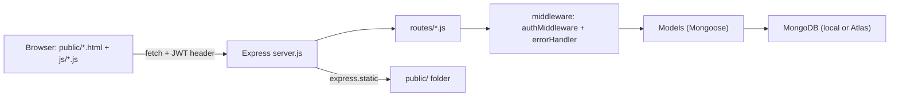
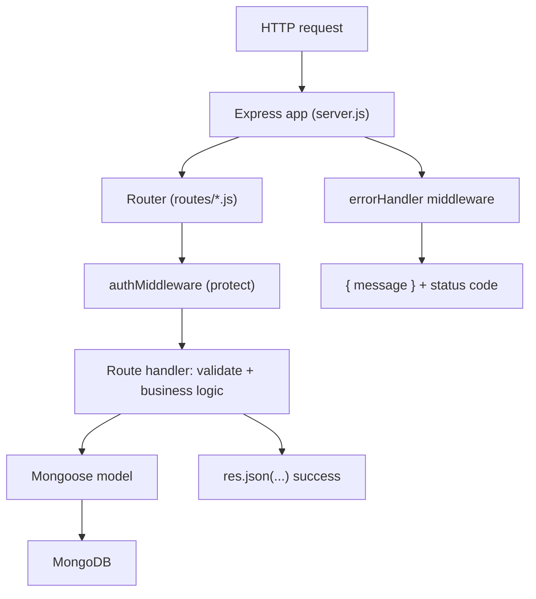
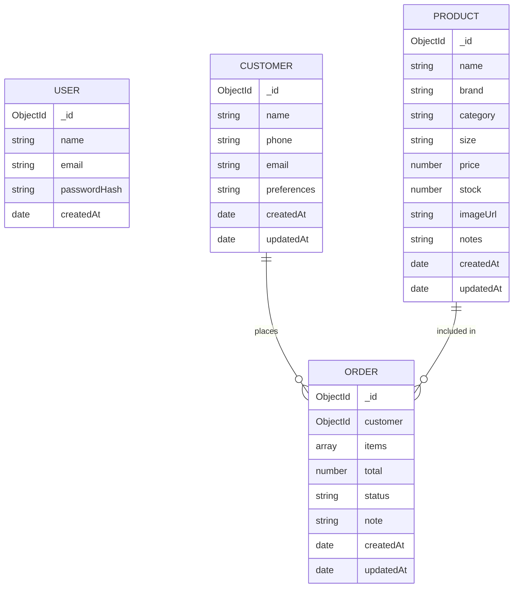

# Perfume Shop Manager — Technical Architecture Document

## 1. Architecture Design

One Node.js/Express process serves both the REST API and the static frontend. The browser talks to the API with `fetch()` and a JWT in the `Authorization` header.



## 2. Technology Description

- **Frontend**: plain HTML5 + CSS3 + Bootstrap 5.3 (CDN) + Bootstrap Icons (CDN) + Chart.js (CDN, dashboard only) + vanilla JavaScript (`fetch`). No frameworks, no build tools (React/Vue/jQuery/Tailwind/TypeScript are explicitly excluded by the requirements).
- **Backend**: Node.js + Express 4 (CommonJS `require`) + Mongoose 8.
- **Auth**: `jsonwebtoken` (JWT, 8h expiry) + `bcryptjs` password hashing.
- **Config**: `dotenv`.
- **Dev**: `nodemon`.
- **Database**: MongoDB (local `mongodb://127.0.0.1:27017/perfume_shop` or MongoDB Atlas via `MONGO_URI`).
- **Entry point**: `server.js`. Scripts: `start`, `dev`, `seed`.
- **Note**: the skill guideline suggests React/Vite/Tailwind and `vite-init`; the user's explicit requirement forbids these, so the plain-HTML + Express structure in the PRD/folder layout is used instead.

## 3. Route Definitions

### Static pages (served by `express.static('public')`)

| Route | Purpose |
|-------|---------|
| /login.html | Staff login (public) |
| /index.html | Dashboard (login required, enforced client-side) |
| /products.html | Perfume management |
| /customers.html | Customer management |
| /orders.html | Sales orders + receipts |
| /catalogue.html | Public catalogue (no login) |

### API routes

| Method | Route | Purpose |
|--------|-------|---------|
| POST | /api/auth/login | Public — returns `{ token, user }` |
| GET | /api/products/public | Public — in-stock products for catalogue (filters + pagination) |
| GET | /api/products | Private — list with search/category/price/pagination |
| GET | /api/products/:id | Private — single product |
| POST | /api/products | Private — create |
| PUT | /api/products/:id | Private — update |
| DELETE | /api/products/:id | Private — delete (blocked if used in non-cancelled orders) |
| GET | /api/customers | Private — list with search + pagination |
| GET | /api/customers/:id | Private — single customer |
| POST | /api/customers | Private — create |
| PUT | /api/customers/:id | Private — update |
| DELETE | /api/customers/:id | Private — delete (blocked if the customer has orders) |
| GET | /api/orders | Private — list with status/date filters + pagination (customer populated) |
| GET | /api/orders/:id | Private — single order |
| POST | /api/orders | Private — create order (validates and reduces stock, computes total) |
| PUT | /api/orders/:id | Private — edit order (restores old stock, applies new stock) |
| PATCH | /api/orders/:id/cancel | Private — mark Cancelled and restore stock |
| DELETE | /api/orders/:id | Private — delete (restore stock first if Completed) |
| GET | /api/dashboard/summary | Private — KPI summary using only Completed orders |

## 4. API Definitions

```js
// POST /api/auth/login
Request  = { email: string, password: string }
Response = { token: string, user: { id, name, email } }

// GET /api/products?search=&category=&minPrice=&maxPrice=&page=1&limit=8
Response = { items: Product[], page: number, totalPages: number, totalItems: number }

// POST /api/orders
Request  = { customer: ObjectId, items: [{ product: ObjectId, quantity: number }], note?: string }
Response = Order  // items store a snapshot of { name, price } plus product ref and quantity

// Error shape (all endpoints)
Response = { message: string }   // 400 validation, 401 not logged in, 404 not found, 500 server error

// GET /api/dashboard/summary
Response = {
  todaySales, monthSales, totalOrders, totalProducts, totalCustomers,
  lowStock: Product[],
  bestSellers: [{ name, quantitySold, revenue }],
  salesLast7Days: [{ date: "YYYY-MM-DD", total: number }]
}
```

## 5. Server Architecture Diagram



## 6. Data Model

### 6.1 Data Model Definition



### 6.2 Schema Definitions, Indexes and Initial Data

Indexes/constraints are expressed through Mongoose:
- `User.email`: unique + lowercase.
- `Product.category`: enum `[Men, Women, Unisex, Oud, Fresh, Floral]`; `price >= 0`; `stock >= 0` and integer.
- `Customer.phone`: unique and required.
- `Order.items`: at least 1 item, each `quantity >= 1`; snapshot `name` and `price`.
- `Order.status`: enum `[Completed, Cancelled]`, default `Completed`.

Initial seed data: one admin (`admin@perfume.com` / `admin123`, bcrypt-hashed), ~10 sample perfumes across all categories, and ~5 sample customers.

## 7. Stock Logic (no transactions)

1. **Create order**: for each item, load the product, check `stock >= quantity` (reject the whole order naming the product), copy `name` and `price` into the item, decrease stock, and compute `total` on the server.
2. **Edit order**: restore the OLD items' stock first, then validate the NEW items; if validation fails, roll the old stock back and return the error.
3. **Cancel / delete a Completed order**: add the quantities back to stock before saving/removing.
4. Sequential steps with manual rollback are used because a local MongoDB may not be a replica set, so transactions are unavailable.
